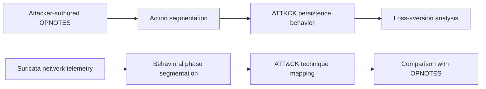

<div align="center">

# Cyber Adversary Insights

**Using large language models to reconstruct attacker actions, MITRE ATT&CK
behavior, and cognitively meaningful patterns from red-team notes and network
telemetry.**

Cyberpsychology · LLM reasoning · MITRE ATT&CK · Suricata IDS


*Conceptual, pre-scripted walkthrough.*

</div>

## Research overview

Security telemetry is good at recording events, but events alone do not explain
how an attack is unfolding or why an attacker chose one action over another. This
project investigates whether LLMs can bridge that gap: turning fragmented cyber
evidence into coherent attacker actions, ATT&CK techniques, and behavioral signals
that can support research into adversary decision-making.

The work developed through two complementary views of the same controlled
red-team exercise. Attacker-authored operational notes (OPNOTES) provide a rich
record of actions and intent. Suricata alerts provide the more realistic defensive
view: low-level, encrypted-payload network telemetry with no direct account of the
attacker's reasoning.



The research contribution is an annotation workflow that:

- segments continuous notes or event streams into meaningful behavioral units;
- uses retrieval-grounded LLM reasoning to connect those units to ATT&CK;
- preserves temporal and prior-action context instead of classifying events in
  isolation; and
- creates structured behavioral evidence for cautious cognitive-trait analysis.

The central finding is that **visibility shapes inference**. Attacker notes expose
intent and host-resident decisions, while network telemetry most reliably
recovers behavior that leaves a visible trace on the wire. In the loss-aversion
study, persistence behavior provided an observable feature for examining risk
propensity. In the telemetry study, Suricata-derived annotations aligned most
strongly with OPNOTES for network-visible phases and were less complete for
actions whose meaning depended on host state or explicit intent.

## Repository and reproduction

The repository preserves the annotation layer behind the research in an
inspectable form:

```text
run_experiments.py          default entry point for both research paths
src/gambit/
├── opnotes.py              CTD, TXT, and JSON preparation
├── suricata.py             combined-CSV normalization
├── analysis.py             action and behavioral-phase segmentation
├── mitre.py                retrieval and ATT&CK response validation
├── pipeline.py             stage persistence and run provenance
└── prompts/v1/             original prompt text
data/
├── opnotes/example.ctd     synthetic OPNOTES-shaped input
├── suricata/example.csv    synthetic Suricata-shaped input
└── mitre/                  historical ATT&CK retrieval context
```

Python 3.11 and the pinned dependencies in `pyproject.toml` define the preserved
environment. The default file runs both annotation paths using the conventional
`data/` layout:

```bash
python3.11 -m venv .venv
source .venv/bin/activate
python -m pip install -e ".[openai]"
python run_experiments.py
```

Each path writes its intermediate actions or phases, validated ATT&CK findings,
and a manifest containing the input hashes, prompt version, model conditions, and
completed stages. A structural run using deterministic placeholder responses is
also available without credentials or network access:

```bash
python run_experiments.py --offline
```

The published CTD and CSV are wholly synthetic. They demonstrate the input shapes
and execute the research stages, but they cannot reproduce participant findings.
Authorized original inputs can be supplied without modifying the analytical
modules.

<details>
<summary><strong>Experiment configuration</strong></summary>

Alternative paths can be provided through the root experiment file:

```python
from pathlib import Path

from run_experiments import ExperimentSettings, run_experiments

run_experiments(
    ExperimentSettings(
        source="opnotes",
        opnotes_input=Path("/authorized/research/OPNOTES.ctd"),
        output_dir=Path("/authorized/research/reproduction-01"),
    )
)
```

The original hosted-model defaults are `gpt-4o`, `gpt-4o-mini`, and
`text-embedding-ada-002`. Credentials are read only from environment variables;
there is no key in the repository or key-valued program argument.

Any server exposing compatible chat-completion and embedding routes can be used
as a separate experimental condition:

```bash
export GAMBIT_API_BASE="http://localhost:8080/v1"
export GAMBIT_EMBEDDING_API_BASE="http://localhost:8081/v1"
export GAMBIT_PRIMARY_MODEL="local-generation-model"
export GAMBIT_UTILITY_MODEL="local-generation-model"
export GAMBIT_EMBEDDING_MODEL="local-embedding-model"
python run_experiments.py
```

</details>

## Publications and research boundary

Hans, S., Gurney, N., Marsella, S., & Hirschmann, S. (2025). *Quantifying Loss
Aversion in Cyber Adversaries via LLM Analysis*. I/ITSEC 2025, Paper No. 25372.
[arXiv:2508.13240](https://doi.org/10.48550/arXiv.2508.13240).

Hans, S., Marsella, S., Hirschmann, S., & Gurney, N. (2025). *Security Logs to
ATT&CK Insights: Leveraging LLMs for High-Level Threat Understanding and
Cognitive Trait Inference*. [arXiv:2510.20930](https://doi.org/10.48550/arXiv.2510.20930).

This public artifact recreates the LLM annotation workflow, not the private
participant dataset, psychometric variables, regression analysis, cross-source
evaluation figures, or every table in the papers. Exact model output is not
guaranteed because the original experiments used provider-hosted model aliases
and retrieval embeddings that can change over time. The original prompts and
historical ATT&CK documents are retained because changing either can change the
annotations. Additional publication and data-handling constraints are recorded in
[`DATA_POLICY.md`](DATA_POLICY.md) and [`SOURCE_BOUNDARY.md`](SOURCE_BOUNDARY.md).

This research is based upon work supported in part by the Office of the Director
of National Intelligence (ODNI), Intelligence Advanced Research Projects Activity
(IARPA), under the Reimagining Security with Cyberpsychology-Informed Network
Defenses (ReSCIND) program, contract N66001-24-C-4504. The views and conclusions
are those of the authors and do not necessarily represent the official policies
of ODNI, IARPA, or the U.S. Government.

No reuse license is granted for the research source code. The MITRE ATT&CK
reference material under `data/mitre/` is covered by the reproduced notice in
`data/mitre/MITRE_LICENSE.txt`.
